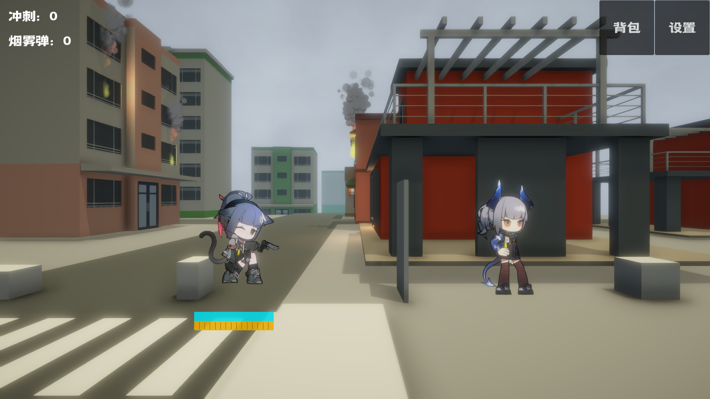
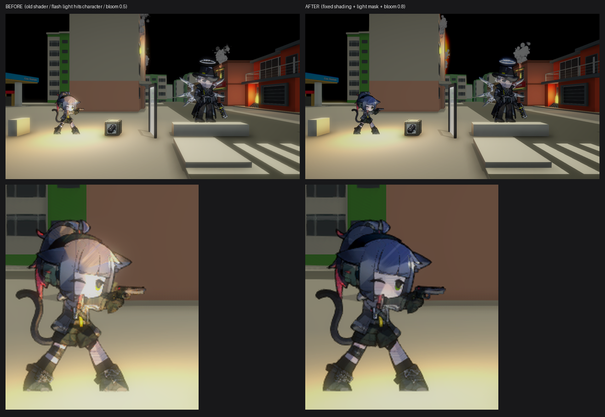

# ARK-Jessica

> 明日方舟同人 · 2D 横版动作 Demo
> Unity 2023.2.22f1 · Built-in Render Pipeline

一个用 Unity 做的横版动作小 Demo：操控「洁西卡」在低多边形城市里移动、跳跃、射击，
配合 Spine 逐帧烘焙的 2D 角色、UniStorm 动态天气、可击碎的玻璃和成套的战斗/背包/任务 UI。



---

## 目录

- [玩法与操作](#玩法与操作)
- [项目结构](#项目结构)
- [如何运行](#如何运行)
- [技术要点](#技术要点)
- [角色光照方案](#角色光照方案)
- [已知问题 / TODO](#已知问题--todo)
- [素材与版权](#素材与版权)
- [License](#license)

---

## 玩法与操作

| 操作 | 按键 |
| --- | --- |
| 移动 | `A` / `D` 或 `←` / `→` |
| 跳跃 | `Space` |
| 射击 | `J` 或 `Left Ctrl` |
| 换弹 | `R` |
| 奔跑 / 冲刺 | `Left Shift` |
| 技能 | `C` |
| 终结技 | `V` |
| 踢击 | `F` |
| 背包 | `B` |

按键映射来自 `ProjectSettings/InputManager.asset`，可在 **Edit → Project Settings → Input Manager** 里改。

当前 Demo 内容：

- 玩家 FSM：Idle / Move / Run / Jump / Attack / Reload / Injured / Die / Deploy
- 三把武器：M9（默认）、Glock 34、TTI MPX，带弹匣与连射 CD
- 敌人：史莱姆（1007）、Cliff（1546），带追击 / 攻击 / 死亡 / 复活状态
- 可破坏玻璃：分层碎裂、碎块物理、闪光反馈（`Assets/Scripts/Glass`）
- 背包 / 商店 / 任务 / 对话 / 存档（JsonMgr）
- UniStorm 3.0 动态天气 + 昼夜，CFXR 粒子特效，PostProcessing v2 后期

---

## 项目结构

```
ARK-Jessica/
├─ Assets/
│  ├─ ArtRes/          美术资源：角色逐帧、敌人、Spine、音频、材质、天空盒
│  │  ├─ Jessica/      玩家各动作的烘焙帧（Idle/Move/Run/Attack/...）
│  │  ├─ Enemy/        敌人立绘与动画帧
│  │  ├─ Materials/    角色材质与光照预设
│  │  └─ Normals_Baked/ 旧法线方案烘焙的法线贴图（当前管线未使用）
│  ├─ Scripts/         游戏逻辑
│  │  ├─ Player/       玩家、武器、状态机
│  │  ├─ Enemy/        敌人基类与各敌人状态
│  │  ├─ Glass/        玻璃破碎系统
│  │  ├─ UI/           面板、背包、任务、HUD
│  │  └─ Data/         配置表、存档、事件
│  ├─ Editor/          编辑器工具（法线烘焙、Spine 烘焙、玻璃生成、阴天光照）
│  ├─ Shaders/         自定义 Shader
│  │  ├─ ARK_SpriteBasicLit.shader   角色基础光照（当前使用）
│  │  └─ ARK_Glass.shader            玻璃
│  ├─ Scenes/          TestScene 为主场景
│  ├─ Prefabs/         预制体
│  ├─ Resources/       运行时加载资源（武器、子弹、UI 图、Json）
│  └─ Spine/           spine-unity 运行时
├─ Packages/
├─ ProjectSettings/
├─ Tools/              Python 脚本：走路帧提取 / ESRGAN 超分（模型文件未入库）
└─ Docs/               截图与文档
```

---

## 如何运行

1. 用 **Unity Hub** 安装 **2023.2.22f1**（项目里 `ProjectSettings/ProjectVersion.txt` 有记录）。
2. `Add project from disk` 选择本仓库根目录。
3. 打开 `Assets/Scenes/TestScene.unity`，点 **Play**。

> 首次打开需要导入约 2 GB 美术资源，视机器性能可能需要等待几分钟。
>
> 仓库对大文件使用 **Git LFS**（`*.obj`、`*.mp4`）。克隆前请先 `git lfs install`，
> 否则塔楼模型和视频会是 LFS 指针文件。

其他场景：`BeginScene`（开始界面）、`GlassTestScene`（玻璃演示）、`SpineTestScene`（Spine 测试）、
`FrameTestScene`（帧动画测试）。

---

## 技术要点

| 模块 | 方案 |
| --- | --- |
| 角色动画 | Spine 动画 → 逐帧烘焙成 Sprite（`Editor/SpineLocomotionBaker.cs`），运行时走 SpriteRenderer + Animator |
| 角色光照 | 自定义 `ARK/Sprite Basic Lit`：平面法线 + 环境光（SH）+ 主光半兰伯特 + 限幅点光，详见下节 |
| 场景光照 | UniStorm 3.0 昼夜/天气 + 三色环境光（`Editor/Overcast/OvercastLighting.cs` 提供一键阴天） |
| 后期 | Unity PostProcessing v2（Bloom / ColorGrading / AO / Fog）+ Kino Bloom |
| 摄像机 | Cinemachine（跟随 + 战斗镜头） |
| 特效 | Cartoon FX Remaster（CFXR） |
| 玻璃 | 自定义分层破碎：`GlassPanel` 维护裂纹层级，`GlassFragment` 走对象池 |
| 数据 | 轻量 Json 序列化（`Scripts/Json`）+ 配置表（TaskCfg / PlayerItemData） |

---

## 角色光照方案

2D 手绘角色 + 3D 场景，最容易踩的坑是「角色被某个强光源打爆」——枪口闪光、火堆这类点光
距离角色只有一两米，强度却是 HDR 的，任何逐光源物理光照都会把角色烧成白色。

当前方案（`Assets/Shaders/ARK_SpriteBasicLit.shader`）：

1. **不用法线贴图**。2D 精灵没有厚度，法线固定为「朝向相机」的平面法线，整张均匀受光。
2. **环境光 + 主光**：环境光取场景 SH 球谐（阴天/夜里会自然变暗）；主光做半兰伯特，
   背光面不会一下全黑，光强先归一化再封顶，HDR 强光只会让颜色变亮、不会洗白。
3. **点光限幅**：点光/聚光单独一个 add pass，最多只加 `_LocalLightAmount`（默认 30%），
   闪光/火堆能给角色一点暖色，但永远不会过曝。
4. **LDR 输出**：最终颜色限制在 0–1，不会喂给 Bloom 变成「角色在发光」。

材质面板可调：

| 参数 | 默认 | 说明 |
| --- | --- | --- |
| `_Brightness` | 1.0 | 整体亮度 |
| `_MinBrightness` | 0.45 | 最暗保底，夜里不会黑成剪影 |
| `_AmbientAmount` | 0.55 | 环境光占比 |
| `_KeyLightAmount` | 0.90 | 主光占比 |
| `_LightWrap` | 0.35 | 光照包裹，越大背光面越亮 |
| `_ShadowTint` | 淡蓝 | 背光面色调 |
| `_LocalLightAmount` | 0.30 | 点光上限，设 0 则完全不吃点光 |

> 早期版本用过「逐帧烘焙法线贴图 + 法线光照」的方案（`ARK_SpriteNormalMappedLit`，已备份在
> 仓库外）。它体积大（1800+ 张法线图）、且极易被近距离点光打爆，因此改成了现在的基础光照。
> `Assets/Scripts/ARK_SpriteNormalBinder.cs` 仍然保留，但材质没有 `_BumpMap` 时会自动让路。



---

## 已知问题 / TODO

- 场景亮度强依赖 UniStorm 的运行时状态，不同时间点进入画面差异较大。
- 任务/商店/背包系统只做了基础流程，缺少完整的数据校验。
- 敌人 AI 只有追击/攻击两个状态，缺少巡逻与受击反馈。
- 移动端分辨率与 UI 适配未处理。
- 部分美术资源来自网络/插件，仅用于学习演示（见下节）。

---

## 素材与版权

- 《明日方舟》及其角色、立绘、名称版权归 **上海鹰角网络（Hypergryph）** 所有。
  本项目是**非商业同人 Demo**，仅用于学习与技术演示，禁止用于任何商业用途。
- 第三方插件/素材（UniStorm、Cartoon FX Remaster、PostProcessing、spine-unity、
  Toony Colors Pro、Fantasy Skybox、SimplePoly City 等）版权归各自作者所有，
  请遵守各自的授权协议，不要将本仓库当作这些资源的二次分发渠道。
- 项目内的原创代码与 Shader 采用 MIT 协议（见下），**不包含**任何美术资源。

---

## License

代码部分（`Assets/Scripts`、`Assets/Shader*`、`Assets/Editor`）采用 [MIT License](LICENSE)。
美术、音频、字体及第三方插件不在授权范围内。
